<div align="center">

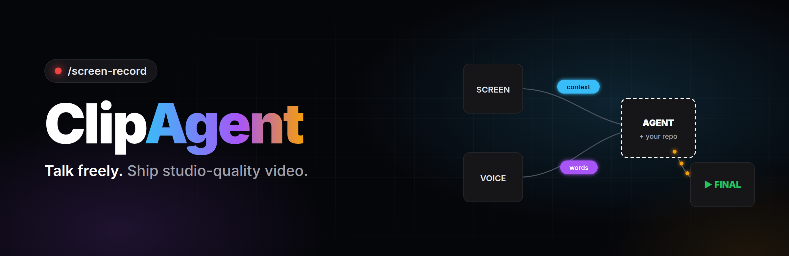

# ClipAgent

### Type `/screen-record`. Talk. Stop. Get a studio-edited video.

**ClipAgent turns your coding agent into a video studio.** It records your screen, webcam and voice while you talk freely, with no script, no notes, and no fear of mistakes. Then it edits the whole thing for you: it cuts the flubs, zooms where you click, cleans your voice and webcam, and builds **animated explainers from your own repo, docs and the web**, synced to the exact words you say.

[](#install)
[](#install)
[](#privacy)
[](#install)
[](LICENSE)

<a href="demo/clipagent-demo.mp4">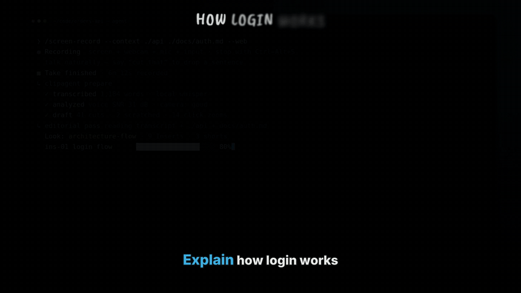</a>

<sub>▶ <a href="demo/clipagent-demo.mp4"><b>Watch the full demo (with sound)</b></a>: edited by ClipAgent itself, from a raw take to the finished cut.</sub>

<a href="brag-output/brag.mp4">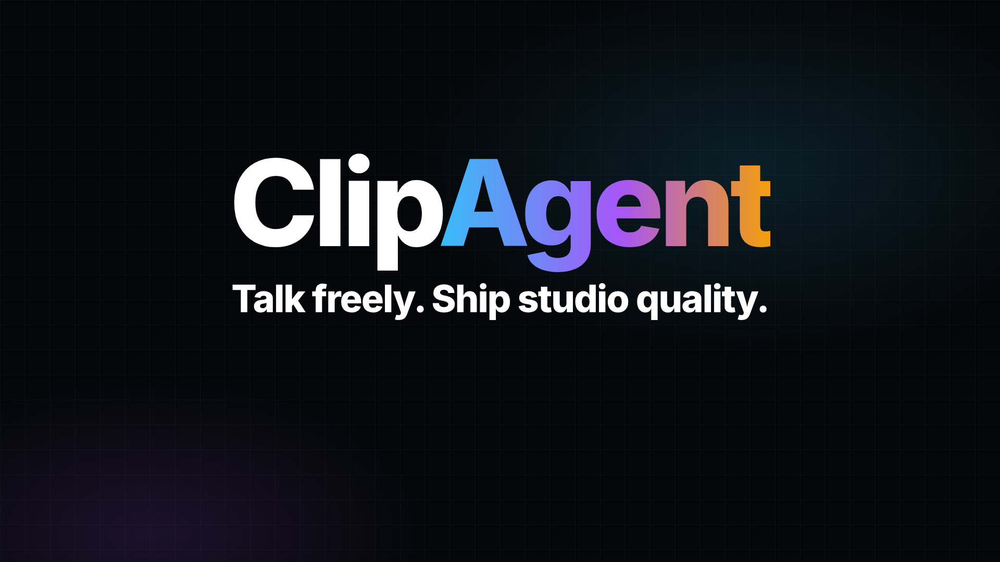</a>

<sub>🎬 <a href="brag-output/brag.mp4"><b>20-second launch video</b></a>, made with the <a href="https://github.com/latent-spaces/brag"><code>/brag</code></a> skill from ClipAgent's own renders.</sub>

</div>

---

## Why ClipAgent?

Recording a good technical video today means three jobs: **presenter**, **motion designer**, and **editor**. Most developers are good at the first one and dread the other two. So the videos never get made, or they ship as a 14-minute screen capture full of "umm, wait, let me redo that".

ClipAgent does the second and third jobs for you. It knows what you're talking about because you give it your **Context Pack**: your repository, your docs, your URLs, and (if you allow it) the web. So instead of generic stock B-roll, the animations show *your* architecture, *your* code and *your* numbers.

> You explain how login works → your phone app, API gateway and session store appear on screen → the access token travels between them **on the exact word you say "sends"** → the gateway validates it against the session store **as you say "validates"**.

## What you get

| | |
|---|---|
| 🎙️ **Talk without fear** | Retakes, false starts, filler words and dead air are cut automatically. Flubbed a sentence? Press `Ctrl+Alt+X` or just say **"cut that"** and the sentence is gone. |
| 🧠 **Animations from *your* context** | Architecture diagrams, packet flows, real code snippets, doc excerpts, charts, math, whiteboard sketches and stickman stories, built from your repo and docs. |
| ⏱️ **Word-perfect sync** | Every animation Beat is anchored to a spoken word, not a timestamp, so it stays in sync after every cut. |
| 🎨 **Five studio Looks** | Architecture Flow, Neon Telestrator, Math Vector (3Blue1Brown style), Whiteboard SaaS and Stickman Story. One consistent production style per video. |
| 🖱️ **Smart screen treatment** | Zooms on the clicks that matter, click ripples or pointer hands, marching-ants highlights, curved arrows, shortcut keycaps, macOS window chrome. |
| 📷 **Webcam that looks good** | Auto white balance, exposure, denoise and sharpening. Weak webcams are kept small automatically, and a phone camera file is synced by audio. |
| 🔊 **Broadcast audio** | Neural denoise (RNNoise), EQ, de-ess, compression, -14 LUFS loudness, synthesized sound effects, and an optional music bed that ducks under your voice. |
| 🔍 **Self-checking** | No human review needed: every Insert is checked for clipped or overlapping text, blank frames and palette drift, and compared with the Look's reference frames. Anything that fails twice is dropped, never shipped. |
| 📦 **Ready to publish** | The final video, plus 9:16 shorts, a thumbnail, captions (.srt), YouTube chapters, publishing copy (YouTube, LinkedIn, X) and a report. |
| 🔒 **Private by design** | Everything runs on your machine with no API keys. Keystrokes are never stored as text, and secrets on screen are hunted and redacted before render. |

## How it works

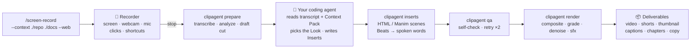

**The agent is the editor; the engine does the mechanical work.** The `clipagent` CLI captures, transcribes (local Whisper), analyzes and renders. Your coding agent (Claude Code or Codex) makes the editorial calls by writing a single `edl.json`: what to cut, where to zoom, which Look to use, and which Inserts to build from which Primitives, anchored to which words.

## The five Looks

Each Look is one production style for the **whole** video: how Inserts look and move, how the screen recording is framed and annotated, the transitions, the chapter cards, the captions and the sound.

<div align="center">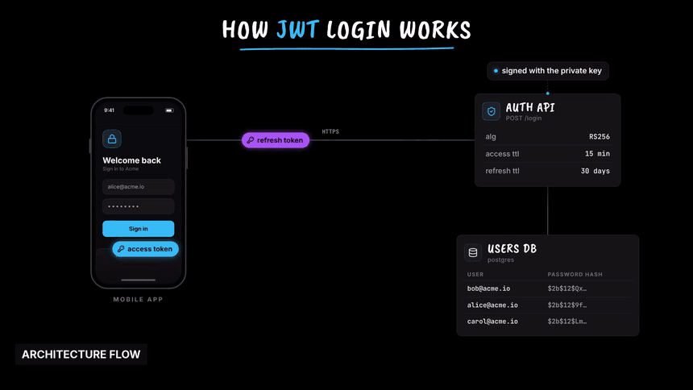</div>

<table>
<tr>
<td width="50%">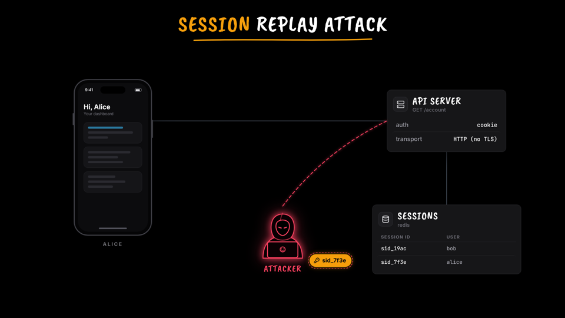<br><b>Architecture Flow</b>: dark system-design explainer. Charcoal service cards, glowing packet streams, color-coded token pills, validation checkmarks, latency spinners and threat actors.</td>
<td width="50%">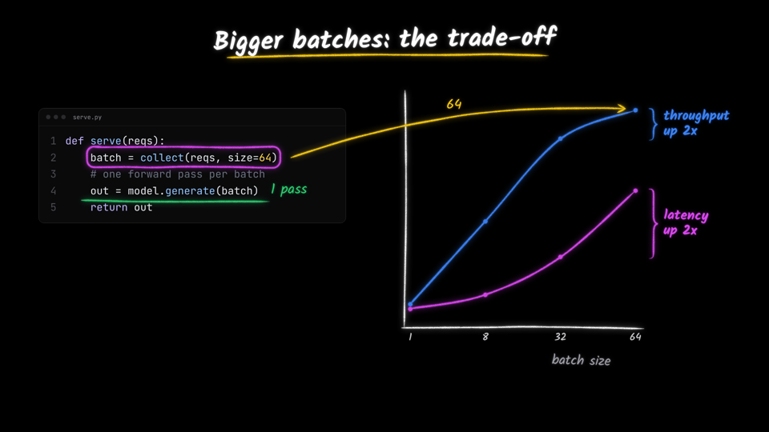<br><b>Neon Telestrator</b>: black canvas with hand-drawn neon ink. Loops and notes drawn over benchmark screenshots, 3D data plots that orbit, and red pointer callouts.</td>
</tr>
<tr>
<td>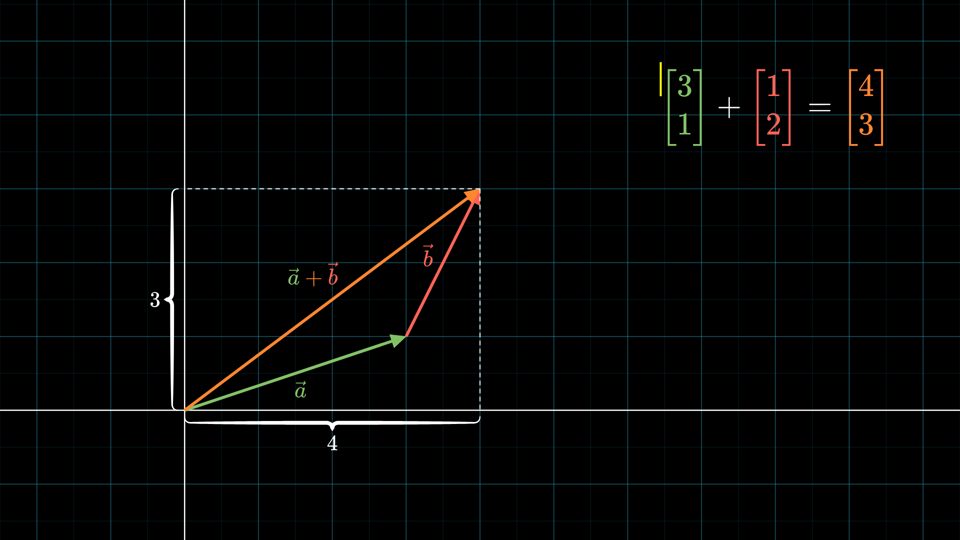<br><b>Math Vector</b>: 3Blue1Brown-style programmatic math. LaTeX, draw-on strokes, morphing, curly braces, live number counters and persistent concept colors.</td>
<td>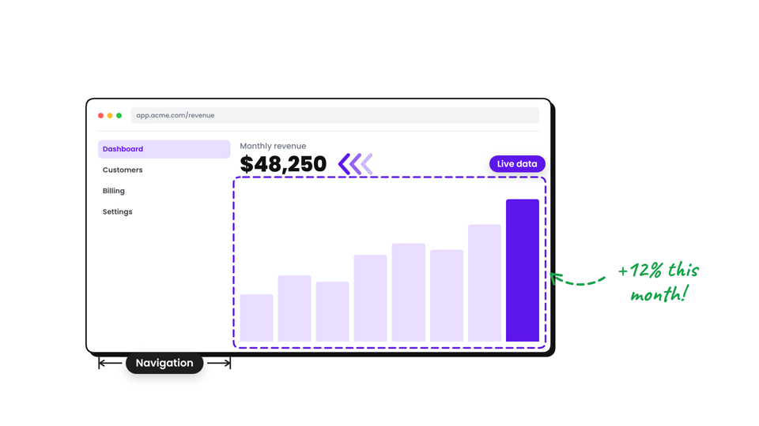<br><b>Whiteboard SaaS</b>: white whiteboard with a hand drawing every stroke, purple keyword emphasis, black chapter cards, and annotated UI with marching ants and pointer hands.</td>
</tr>
<tr>
<td>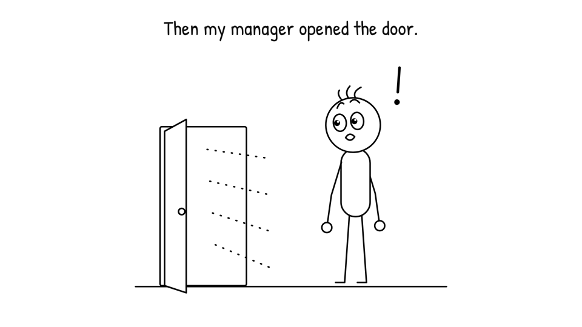<br><b>Stickman Story</b>: minimalist line-art stickman with blinking, typing, pointing and victory micro-animations, plus a clean macOS-framed UI walkthrough mode.</td>
<td valign="top"><br><b>Pick one, or let the agent pick.</b><br><br><code>/screen-record --look neon-telestrator</code><br><br>The agent chooses from your topic and Context Pack: system design → Architecture Flow, AI news → Neon Telestrator, algorithms → Math Vector, product demos → Whiteboard SaaS, stories and "why" videos → Stickman Story.</td>
</tr>
</table>

### Watch every Look in a real edited video

Each of these went through the full pipeline (raw take → transcript → the agent's edit → Inserts → self-check → render), with nothing touched by hand afterwards. Click a poster to play it (with sound).

<table>
<tr>
<td width="50%"><a href="demo/clipagent-demo.mp4">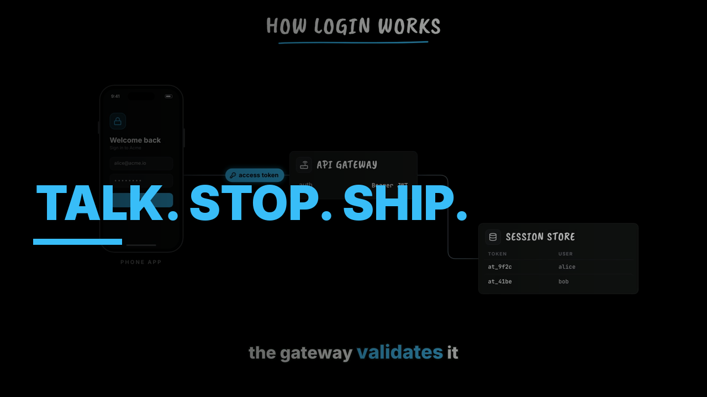</a><br><b>Architecture Flow</b> · 52 s · how ClipAgent itself works, with a JWT login flow built from the spoken words</td>
<td width="50%"><a href="demo/looks/neon-telestrator/video.mp4">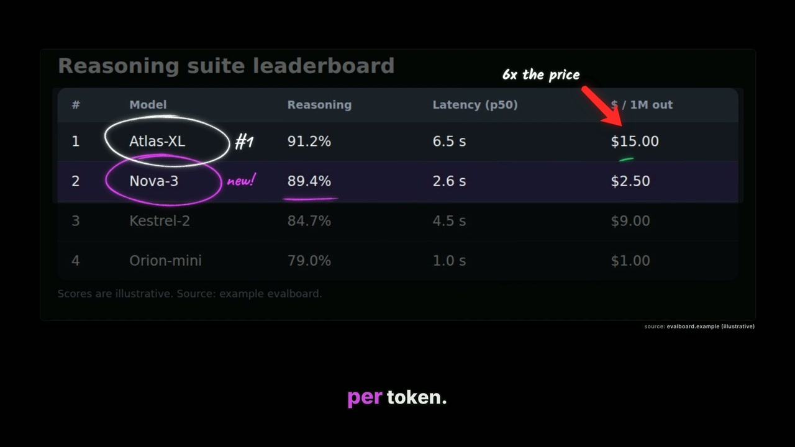</a><br><b>Neon Telestrator</b> · 41 s · an AI pricing story: telestrated leaderboard, a price that strikes through, a 3D cost/accuracy/latency plot</td>
</tr>
<tr>
<td><a href="demo/looks/math-vector/video.mp4">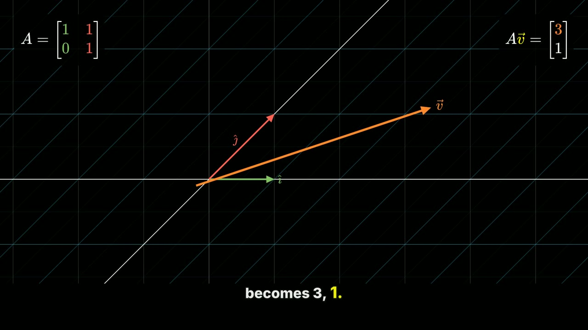</a><br><b>Math Vector</b> · 41 s · a notebook walkthrough: a matrix shears the plane, then gradient descent slides into the minimum with live counters</td>
<td><a href="demo/looks/whiteboard-saas/video.mp4">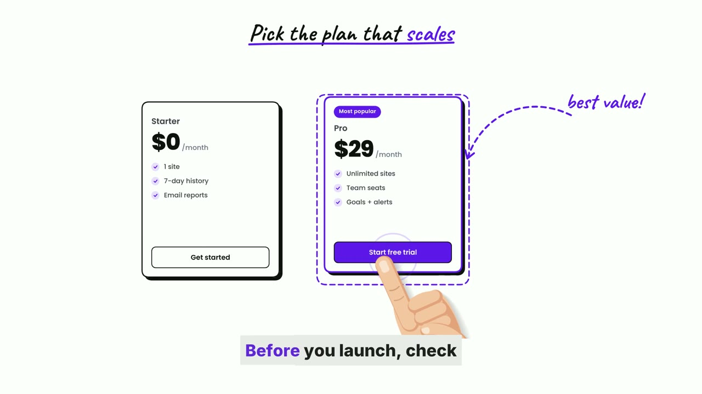</a><br><b>Whiteboard SaaS</b> · 44 s · onboarding for a SaaS dashboard: pointer-hand clicks, a hand-drawn flow, annotated pricing cards, a ticked checklist</td>
</tr>
<tr>
<td><a href="demo/looks/stickman-story/video.mp4">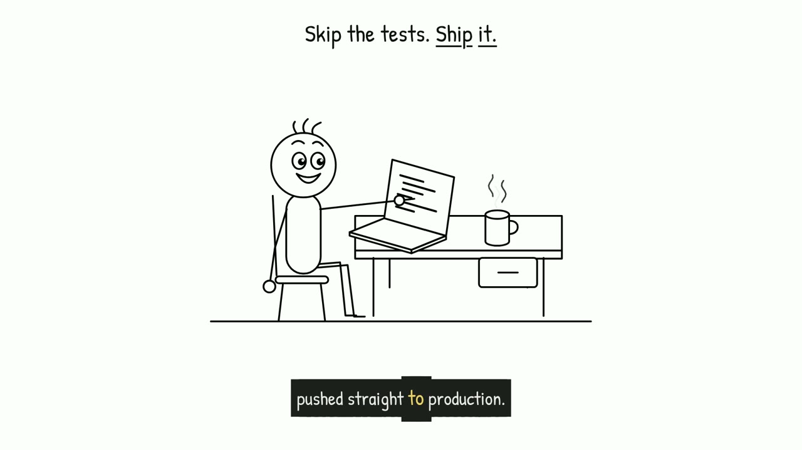</a><br><b>Stickman Story</b> · 38 s · "why I test before Friday deploys": hard-cut stickman scenes inside a macOS-framed CI walkthrough</td>
<td valign="top"><br>The narration, the screen page, the agent's <code>edl.json</code> and the self-check report for each one are in <a href="demo/looks"><code>demo/looks/&lt;look&gt;/source/</code></a>. The voices are an open-source TTS voice (Piper); the products, models and numbers are fictional.</td>
</tr>
</table>

## Install

**Requirements:** [ffmpeg](https://ffmpeg.org/download.html) ≥ 6 and [uv](https://docs.astral.sh/uv/). Linux, macOS or Windows.

**Claude Code (plugin):**

```text
/plugin marketplace add truecallerabreham/Clipagent
/plugin install clipagent@clipagent
```

**Claude Code or Codex (script)**, which links the skill into `~/.claude/skills` and `~/.codex/skills`:

```bash
curl -fsSL https://raw.githubusercontent.com/truecallerabreham/Clipagent/main/install.sh | bash
```

On the first run, the agent runs `clipagent doctor` and installs the recorder app for your OS (`clipagent install-recorder`, from GitHub Releases).

<details>
<summary><b>Platform notes</b></summary>

- **Math Vector with real Manim (optional):** the HTML engine already renders the Look with real LaTeX glyphs (KaTeX). To also use ManimCE: install `libcairo2-dev libpango1.0-dev pkg-config` (or the `cairo pango` Homebrew formulae) plus a LaTeX distribution, then `uv sync --project engine --extra manim`.
- **macOS:** grant the recorder *Screen Recording*, *Camera*, *Microphone* and *Input Monitoring* in System Settings → Privacy & Security.
- **Linux (Wayland):** the screen is captured through the desktop portal (you pick the screen once). Global clicks and shortcuts need `sudo usermod -aG input $USER` (then log out and back in); without it ClipAgent still works and estimates clicks from the video. AppImages need `libfuse2`.
- **Windows:** allow camera and microphone access for desktop apps.

</details>

## Use it

In Claude Code or Codex:

```text
/screen-record
/screen-record walk through our auth service, use ./api and docs/auth.md
/screen-record --look math-vector explain gradient descent, web search allowed
/screen-record screen only, no camera, I'll add my phone video after
```

Then just talk. Stop with the floating bar, **Ctrl+Alt+S** (**⌘⌥S** on macOS), or by asking your agent. Say **"cut that"** whenever you want to drop the last sentence.

When you stop, the agent prepares, edits, self-checks and renders everything, then hands you `deliverables/`:

```text
~/ClipAgent/sessions/2026-11-02_231754_auth-walkthrough/deliverables/
├── final.mp4          the edited video
├── shorts/            9:16 cut-downs of the strongest moments
├── thumbnail.png
├── captions.srt
├── chapters.txt       YouTube chapters
├── copy.md            title, description, LinkedIn and X posts
└── report.md          what was cut, Inserts made, mismatches, redactions
```

Want a change? Just say it ("make the second diagram shorter", "use my phone video", "no music"). The agent edits `edl.json` and re-renders only what changed.

Already have a recording? `/screen-record edit ~/Videos/raw.mp4 with ./repo as context` imports it.

## The engine CLI

The skill drives this for you, but every step is a plain command:

| Command | What it does |
|---|---|
| `clipagent start --context ./repo --web` | Create a Session and start recording |
| `clipagent stop` · `wait` · `status` | Control the Take |
| `clipagent context add ./README.md` | Amend the Context Pack after recording |
| `clipagent camera phone.mp4` | Use a phone/DSLR file as the camera (synced by audio) |
| `clipagent import raw.mp4` | Start from an existing recording |
| `clipagent prepare` | Ingest, transcribe (local Whisper), analyze, draft the cut |
| `clipagent inserts` | Resolve Beats to words and render every Insert |
| `clipagent qa --stills` | Self-check: automatic checks plus comparison sheets |
| `clipagent render` | Composite, grade, denoise, mix and encode |
| `clipagent deliver` | Shorts, thumbnail, captions, chapters, copy, report |
| `clipagent snap <url>` | Screenshot a web page for telestration (web-enabled Sessions) |
| `clipagent looks` · `doctor` | List Looks · check the machine |

## Privacy

- **Local-first.** Capture, transcription (faster-whisper), rendering and sound design all run on your machine. No accounts, no API keys, no uploads.
- **Keystrokes are never stored as text.** The input log keeps shortcut combos (for keycap badges) and the *fact* that you typed (for timing), never the characters.
- **Secrets are hunted before render.** The agent scans frames and the transcript for keys, tokens, `.env` files and emails, pixelates them for as long as they're visible, and lists every redaction in the report.
- **Web content is opt-in** per Session (`--web`), with sources labeled on screen.

## Repository layout

```text
skills/screen-record/   the agent skill (SKILL.md + reference/), for Claude Code and Codex
engine/                 Python engine: the `clipagent` CLI (uv project)
looks/                  the five Looks + the shared HTML animation runtime
recorder/               Electron recorder: screen, webcam, mic, input events, floating bar
docs/                   design, glossary-backed decisions (adr/), Look specs, project history
demo/                   the demo video and the source it was made from
```

Read [`docs/design.md`](docs/design.md) for the contracts between the parts, [`GLOSSARY.md`](GLOSSARY.md) for the vocabulary, and [`looks/README.md`](looks/README.md) to build your own Look.

## Roadmap

- [ ] User-authored Looks from a style spec
- [ ] Live preview window while the agent edits
- [ ] Multi-take Sessions (record in parts, edit as one)
- [ ] Voice-cloned pickups for words the speaker stumbled on (opt-in)
- [ ] One-click publish to YouTube / LinkedIn

## Project history

ClipAgent started on **26 August 2026** as a video search and clip-extraction pipeline (see [`docs/brainstorms/`](docs/brainstorms/) and [`docs/plans/`](docs/plans/)), grew through a month of milestone-by-milestone video tooling (cutting, merging, transitions, orchestration), and in November 2026 became what it is now: an agent-native screen-recording studio. The full history is in the git log.

## License

[MIT](LICENSE) © 2026 Abreham

<div align="center"><sub>Made by talking to a coding agent. The demo above was edited by ClipAgent itself.</sub></div>
